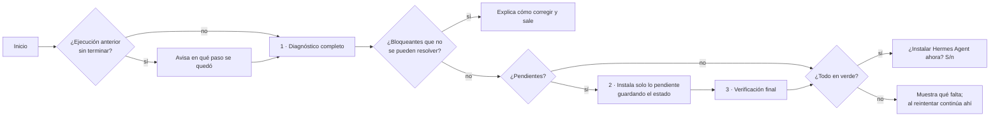

# Preparación para instalar Hermes Agent

Scripts para **Windows, macOS y Linux** que dejan una PC lista para instalar
[Hermes Agent](https://github.com/NousResearch/hermes-agent): revisan qué falta,
instalan **solo** eso y, cuando todo está en verde, ofrecen lanzar el instalador oficial.

```
 ╔════════════════════════════════════════════════════════════════╗
 ║ Preparación para Hermes Agent · macOS arm64                    ║
 ╚════════════════════════════════════════════════════════════════╝

 1) DIAGNÓSTICO (12 verificaciones)
   ✔ LISTO      Git                  2.50.1         ya instalado
   • FALTA      Node.js + npm        —              se instalará Node.js LTS
   ⚠ ACTUALIZAR Python 3.11+         3.9.6          versión menor a 3.11
   ...
   Resultado: 9 listos · 1 por actualizar · 2 por instalar · 0 avisos · 0 bloqueantes

 INSTALACIÓN (solo los 3 pendientes)
 [2/3] ⠹ Python 3.11+       brew install python         ██████░░░░░░░░  33%  14s
```

## ¿Por qué existe?

El instalador oficial de Hermes **da por hecho** algunas cosas que en equipos recién
formateados no existen:

| Sistema | Lo que suele fallar |
|---|---|
| macOS | Sin Xcode Command Line Tools, `git` es un *stub* que no funciona; no hay Homebrew. |
| Linux | Faltan `git`, `curl`, `libatomic1` (Node.js no arranca sin ella), certificados o compiladores. |
| Windows | Política de ejecución `Restricted` (rompe `npm.ps1`), rutas largas desactivadas (`Filename too long`), TLS 1.0 en PowerShell 5.1, sin `winget`. |

## Uso rápido

### macOS y Linux

```bash
curl -fsSL https://raw.githubusercontent.com/xavierguereque/preparacion-instalacion-hermes-agent/main/install.sh | bash
```

Si el equipo no tiene `curl` (algunos Linux mínimos):

```bash
wget -qO- https://raw.githubusercontent.com/xavierguereque/preparacion-instalacion-hermes-agent/main/install.sh | bash
```

### Windows (PowerShell, **sin** abrirlo como Administrador)

```powershell
irm https://raw.githubusercontent.com/xavierguereque/preparacion-instalacion-hermes-agent/main/scripts/prepare-windows.ps1 | iex
```

O descarga el repo y da doble clic en `windows\Preparar-Hermes.bat`.

> Se ejecuta como usuario normal a propósito: Hermes se instala por usuario en
> `%LOCALAPPDATA%\hermes`. Solo se pide permiso de Administrador (UAC) para activar
> las rutas largas y cuando un instalador de `winget` lo requiere.

## Cómo funciona



1. **Diagnóstico**: revisa todo sin modificar nada. Cada elemento queda como
   `LISTO`, `ACTUALIZAR`, `FALTA`, `AVISO` o `ERROR`.
2. **Instalación**: solo lo pendiente; la barra cuenta únicamente esos pasos (`[2/3]`).
   Lo que ya estaba bien aparece como `OMITIDO`. Tras instalar cada paso se vuelve a
   verificar; solo se marca `LISTO` si realmente funciona.
3. **Verificación final** y, si todo está en verde, pregunta si lanzar el instalador
   oficial de Hermes.

### Reanudación

Si el script se interrumpe (Ctrl+C, se cae la red, falla un paso, hay que terminar
la instalación de Xcode), basta con **volver a ejecutar el mismo comando**:

```
 ⚠ Se detectó una ejecución anterior sin terminar en [6/10] Node.js + npm (2026-11-09 14:02).
   Continuando desde ahí: lo que ya se instaló se omitirá.
```

El estado se guarda en `~/.hermes-prep/state` (Windows: `%LOCALAPPDATA%\hermes-prep\state`),
pero **la fuente de verdad siempre es el diagnóstico real**: si alguien desinstaló algo
entre corridas, se detecta y se vuelve a instalar.

## Qué revisa e instala

Obligatorio = bloquea la instalación de Hermes si falla. Recomendado = se intenta,
pero si falla solo deja un aviso (el instalador de Hermes también puede proveerlo).

### macOS (Homebrew)

| Elemento | Mínimo | Cómo se instala | Tipo |
|---|---|---|---|
| macOS / arquitectura | 13+ recomendado | — | Obligatorio |
| Espacio en disco | 5 GB | — | Obligatorio |
| Conexión a GitHub y Hermes | — | — | Obligatorio |
| Xcode Command Line Tools | — | `softwareupdate` (o ventana de Apple) | Obligatorio |
| Homebrew | — | instalador oficial + `brew shellenv` en `~/.zprofile` | Obligatorio |
| Git | 2.25 | viene con Xcode CLT, si no `brew install git` | Obligatorio |
| curl | — | `brew install curl` | Obligatorio |
| Node.js + npm | v20 | `brew install node@24` | Obligatorio |
| Python | 3.11 | `brew install python` | Recomendado |
| ripgrep | — | `brew install ripgrep` | Recomendado |
| FFmpeg | — | `brew install ffmpeg` | Recomendado |
| `~/.local/bin` en PATH | — | se agrega a `~/.zshrc` / `~/.bash_profile` | Obligatorio |

### Linux (apt · dnf · pacman)

Probado en Ubuntu 24.04, Fedora 41 y Arch Linux. También funciona en WSL2.

| Elemento | apt (Debian/Ubuntu) | dnf (Fedora/RHEL) | pacman (Arch) | Tipo |
|---|---|---|---|---|
| Utilidades base (tar, xz, unzip, gzip, sha256sum, certificados) | `xz-utils unzip ca-certificates…` | `xz unzip ca-certificates…` | `xz unzip ca-certificates…` | Obligatorio |
| curl, Git | `curl git` | `curl git` | `curl git` | Obligatorio |
| Compiladores | `build-essential` | `gcc gcc-c++ make` | `base-devel` | Recomendado |
| libatomic | `libatomic1` | `libatomic` | `gcc-libs` | Obligatorio |
| libstdc++ | `libstdc++6` | `libstdc++` | `gcc-libs` | Obligatorio |
| Node.js + npm (v20+) | NodeSource 24.x | repos de Fedora, o NodeSource | `nodejs npm` | Obligatorio |
| Python 3.11+ | `python3 python3-venv python3-pip` (Ubuntu antiguo: PPA deadsnakes) | `python3 python3-pip` | `python python-pip` | Recomendado |
| ripgrep | `ripgrep` | `ripgrep` (RHEL: EPEL) | `ripgrep` | Recomendado |
| FFmpeg | `ffmpeg` | `ffmpeg-free` (RHEL: RPM Fusion) | `ffmpeg` | Recomendado |
| `~/.local/bin` en PATH | `~/.bashrc` / `~/.zshrc` | ← | ← | Obligatorio |

> En Arch se ejecuta `pacman -Syu` una vez (Arch no admite actualizaciones parciales).

### Windows (winget)

| Elemento | Qué hace | Tipo |
|---|---|---|
| Windows 10 1809+ x64/ARM64 | Verifica (32 bits no soportado) | Obligatorio |
| PowerShell 5.1+ | Verifica | Obligatorio |
| TLS 1.2 | Lo activa en la sesión | Obligatorio |
| Política de ejecución | `RemoteSigned` para tu usuario (si estaba `Restricted`) | Obligatorio |
| Espacio en disco y conexión | Verifica | Obligatorio |
| winget | Registra *App Installer*; si no, indica cómo instalarlo de la Store | Obligatorio |
| Rutas largas | `LongPathsEnabled=1` (pide UAC) + `git config core.longpaths true` | Obligatorio |
| VC++ Redistributable | `Microsoft.VCRedist.2015+.x64/arm64` | Recomendado |
| Git | `Git.Git` | Obligatorio |
| Node.js + npm (v20+) | `OpenJS.NodeJS.LTS` | Obligatorio |
| Python 3.11+ | `Python.Python.3.12` (por usuario; ignora el alias de la Store) | Recomendado |
| ripgrep | `BurntSushi.ripgrep.MSVC` | Recomendado |
| FFmpeg | `Gyan.FFmpeg` | Recomendado |

## Opciones

| bash (macOS/Linux) | PowerShell | Qué hace |
|---|---|---|
| `--check-only` | `-CheckOnly` | Solo diagnostica; no instala nada. Código de salida 0 si está listo. |
| `--yes` | `-Yes` | Responde "sí" a todo (incluido lanzar Hermes). |
| `--no-hermes` | `-NoHermes` | No ofrece lanzar el instalador oficial al final. |
| `--reset` | `-Reset` | Borra el estado guardado y empieza de cero. |
| `--no-color` | `-NoColor` | Salida sin colores. |

Con el one-liner se pasan así:

```bash
curl -fsSL https://raw.githubusercontent.com/xavierguereque/preparacion-instalacion-hermes-agent/main/install.sh | bash -s -- --check-only
```

```powershell
& ([scriptblock]::Create((irm https://raw.githubusercontent.com/xavierguereque/preparacion-instalacion-hermes-agent/main/scripts/prepare-windows.ps1))) -CheckOnly
```

## Logs (para reportar fallos)

Cada ejecución crea un log nuevo en la carpeta **Descargas**:

```
Descargas/hermes-prep-logs/hermes-prep-AAAAMMDD-HHMMSS.log
```

| | macOS / Linux | Windows |
|---|---|---|
| Log de cada ejecución | `~/Downloads/hermes-prep-logs/` (Linux: la carpeta de `xdg-user-dir DOWNLOAD` o `~/Descargas` si existe) | Carpeta Descargas del usuario `\hermes-prep-logs\` |
| Estado para reanudar | `~/.hermes-prep/state` | `%LOCALAPPDATA%\hermes-prep\state` |

El log incluye la información del sistema (SO, arquitectura, shell, PATH), el estado
previo, cada fila del diagnóstico e instalación, **la salida completa de cada
instalador** y el resultado final. La ruta se muestra al terminar, también cuando el
script falla o se interrumpe.

**Si algo falla, comparte ese archivo** para diagnosticar y corregir el script.

> Si no se puede escribir en Descargas (p. ej. macOS negó el permiso a la Terminal),
> el log se guarda en `~/.hermes-prep/` y el script indica la ruta.

## Solución de problemas

| Síntoma | Qué hacer |
|---|---|
| `Sin acceso a github.com` | Revisa internet, proxy corporativo o antivirus que intercepte HTTPS. |
| macOS: se abrió una ventana de Apple y el script terminó | Termina la instalación de Xcode CLT y vuelve a ejecutar: continúa ahí. |
| Node "menor a v20" aunque se instaló | Hay otro Node antes en el PATH (p. ej. `nvm`). Ejecuta `nvm install --lts` o quita la versión vieja. |
| Windows: "fijada por directiva de grupo" | La política de ejecución la controla TI; pide `RemoteSigned`. |
| Windows: `winget` no aparece | Instala **App Installer** desde Microsoft Store y vuelve a ejecutar. |
| Windows: el antivirus bloquea `uv.exe` de Hermes | Es un falso positivo conocido; agrega `%LOCALAPPDATA%\hermes` a las exclusiones (manual). |
| Windows: `Filename too long` tras activar rutas largas | Cierra sesión de Windows y vuelve a entrar. |

## Estructura del repo

```
install.sh                    lanzador universal macOS/Linux (one-liner)
scripts/prepare-macos.sh      script autocontenido para macOS (bash 3.2)
scripts/prepare-linux.sh      script autocontenido para Linux
scripts/prepare-windows.ps1   script autocontenido para Windows (PowerShell 5.1+)
windows/Preparar-Hermes.bat   doble clic para Windows
tests/check-common-blocks.sh  verifica que macOS y Linux compartan la misma UI/motor
docs/requisitos-hermes.md     notas de requisitos y decisiones (Obsidian)
.github/workflows/ci.yml      shellcheck, PSScriptAnalyzer y pruebas en contenedores
```

Cada script es **un solo archivo** a propósito: así funciona con `curl | bash` e
`irm | iex` sin descargar dependencias. Por eso la UI y el motor se repiten en los
scripts de macOS y Linux; `tests/check-common-blocks.sh` evita que se desincronicen.

## Desarrollo y pruebas

```bash
./scripts/prepare-macos.sh --check-only
```

```bash
docker run --rm -v "$PWD/scripts:/s:ro" ubuntu:24.04 bash /s/prepare-linux.sh --yes --no-hermes
```

```bash
./tests/check-common-blocks.sh
```

Checklist manual en Windows (no se puede automatizar del todo en CI):

1. En una PC limpia, abrir PowerShell **normal** y ejecutar el one-liner con `-CheckOnly`.
2. Ejecutar sin opciones, aceptar el UAC de rutas largas y esperar a que termine en verde.
3. Cerrar la ventana a mitad de una instalación y volver a ejecutar: debe avisar el paso y omitir lo ya instalado.
4. Ejecutar una tercera vez: todo debe salir como `LISTO` / `OMITIDO`.
5. Aceptar "¿Instalar Hermes Agent ahora?" y confirmar que el instalador oficial arranca.
