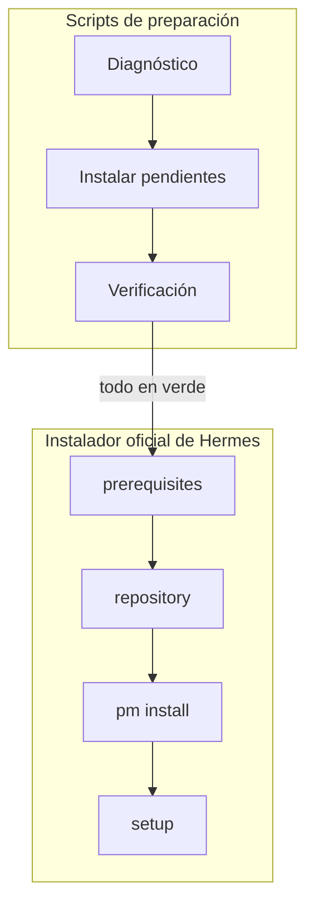

---
tags:
  - hermes-agent
  - instalacion
  - requisitos
fecha_modificacion: 2026-11-10
estado: activo
---

# Requisitos de Hermes Agent

Nota de referencia para los scripts de preparación. Ver también [[#Decisiones de diseño]] y el `README.md` del repo.

## Lo que exige el instalador oficial

Revisado el 2026-11-09 sobre `scripts/install.sh` e `install.ps1` de `NousResearch/hermes-agent`.

### `install.sh` (Linux / macOS)

| Requisito | Comportamiento del instalador |
|---|---|
| git | **Debe existir.** En macOS sustituye el stub vía Homebrew o Xcode CLT (espera hasta 15 min). |
| curl | **Debe existir.** |
| tar, sha256sum/shasum | Los usa para descargar y verificar `uv`. |
| libatomic.so.1 (glibc) | Necesaria para Node.js; puede pedir `sudo` para instalarla. |
| libstdc++ (musl) | Debe estar instalada. |
| uv 0.13.5 | Lo descarga él mismo (pineado, con SHA-256); ignora el `uv` del sistema. |
| Python | Lo toma de `pm/lock.json` (fallback 3.14) y lo instala con `uv`. |
| Node.js, Chromium, ripgrep, FFmpeg, deps Python | Los instala su gestor interno (`hermes pm install`). |

Etapas: prerequisites → repository → venv → python-deps → config → products → setup → gateway → complete.

### `install.ps1` (Windows nativo)

- Usa PortableGit y `uv` pineados; ignora los del sistema.
- Instala en `%LOCALAPPDATA%\hermes`; `hermes` queda en el PATH del usuario.
- **No valida**: versión de PowerShell, política de ejecución, TLS, espacio en disco, VC++ Redist.
- Fallos típicos: `Filename too long`, TLS/proxy (no reintenta con mirror), antivirus bloqueando `uv.exe`, disco lleno, directorio de instalación ocupado.

## Qué cubren nuestros scripts

Los scripts aseguran lo que el instalador oficial **da por hecho** (git, curl, libatomic, certificados, rutas largas, política de ejecución) y, además, dejan instalado Node, Python, ripgrep y FFmpeg a nivel sistema para que el gestor interno de Hermes no falle en equipos limpios.

## Decisiones de diseño

- **Un archivo por SO**: requisito para que funcione con `curl | bash` / `irm | iex`. La UI y el motor se duplican entre macOS y Linux; `tests/check-common-blocks.sh` evita que se desincronicen.
- **El diagnóstico es la fuente de verdad**; el archivo de estado solo indica dónde se quedó, para avisar y reintentar desde ahí.
- **Windows sin elevar**: Hermes se instala por usuario; elevar todo el script podría instalarlo en el perfil del administrador. Solo se pide UAC donde hace falta.
- **Obligatorio vs. recomendado**: Python, ripgrep, FFmpeg, compiladores y VC++ son recomendados porque el gestor de Hermes también puede proveerlos; si fallan, se avisa sin bloquear.
- **Bash 3.2** (macOS) y **PowerShell 5.1** como mínimos.
- **Log por ejecución en Descargas** (`hermes-prep-logs/hermes-prep-AAAAMMDD-HHMMSS.log`): un archivo nuevo por corrida, fácil de encontrar y compartir cuando algo falla. Incluye sistema, estado previo, cada fila, salida completa de instaladores y resultado. Si Descargas no es escribible, cae a `~/.hermes-prep/`.

## Fallos vistos en campo

- **2026-11-10 · MacBook Air (macOS 26.5 → 27.2) · v1.0.0** — cinco corridas, tres causas:
  1. Diagnóstico falso de "falta Node/Python/FFmpeg": la terminal no tenía `/opt/homebrew/bin` en el PATH. v1.0.1 carga `brew shellenv` antes del diagnóstico.
  2. Al actualizar a macOS 27 e instalar Xcode.app, la licencia de Xcode sin aceptar bloqueó `/usr/bin/git` y todo `brew`. v1.0.1 lo detecta (`xcodebuild -license check`) en el paso Xcode y pide aceptarla.
  3. El instalador oficial falló al clonar (`curl 56 Connection reset`): fue la red. v1.0.1 lee el log del instalador oficial y, solo si fue un corte de red, ofrece reintentos con HTTP/1.1 (solo para ese proceso, vía `GIT_CONFIG_*`).

## Pendientes / ideas

- [ ] Probar en una PC Windows real (checklist en el README).
- [ ] Soporte opcional para Alpine (apk) si llega a necesitarse.
